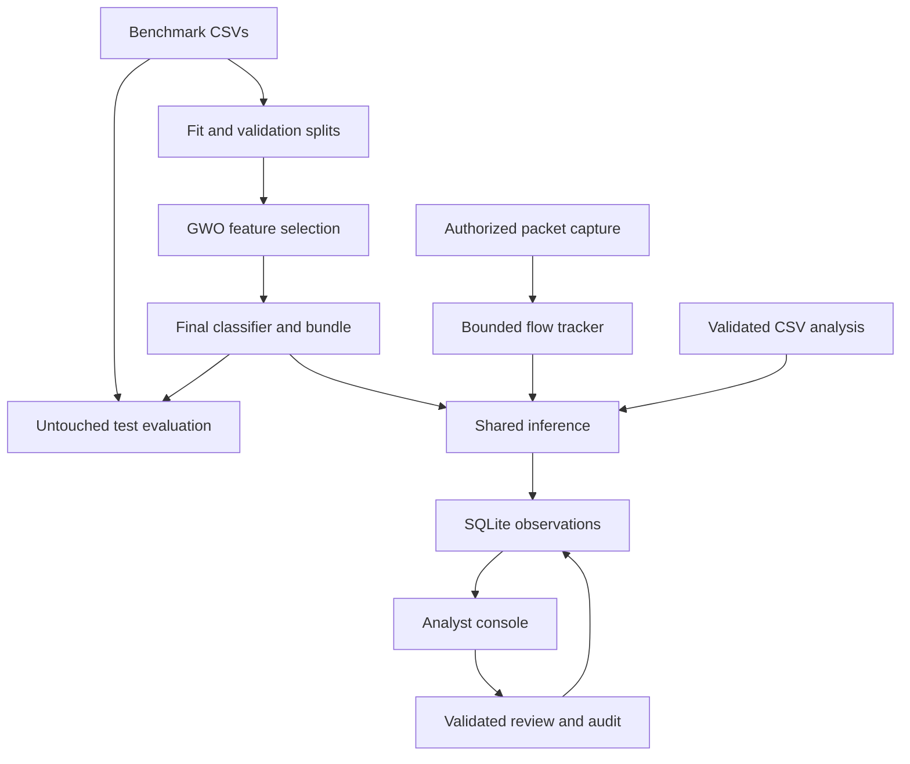
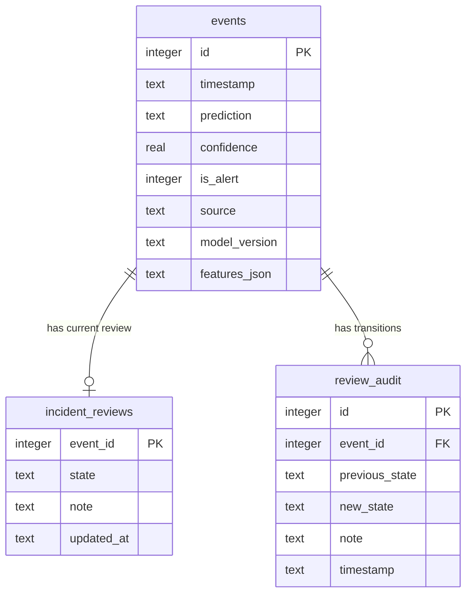

# Architecture and implementation boundaries

The existing Python / scikit-learn / Streamlit / SQLite stack is retained. There is no new parallel detector, web API or authentication model.

The optional compact20 bundle is rebuilt from the validation-selected runtime mask, then carries its own calibration alert threshold. CSV, probe, PCAP and live capture use the same saved inference engine. Flow observation time and event storage time are separate; PCAP and probe imports use atomic batch tokens. The probe uses local sockets, the passive collector requires a supported adapter, and PCAP reads headers without capture privileges. Research exports and per-family audits read completed measurements; they do not promote models automatically.

`benchmark.py` is an isolated research entry point, not a second runtime detector. It reuses the existing UNSW preprocessing, RF factory and GWO selector. It shares rows across 42-feature and 35-feature comparisons, groups selection fit/validation by 35-feature input hashes, and excludes overlapping test inputs regardless of label. After all masks are fixed, it refits preprocessing and final classifiers on the full cleaned training partition. It writes reports only to a new benchmark directory; `train.py`, deployment artifacts and event storage retain their existing behavior. See `docs/MATCHED_BENCHMARK.md` for the executed protocol and limitations.

Training fits categorical encoders and numeric scaling only on the fitting partition. Validation scores guide GWO. The selected and baseline models are refitted on the combined fitting/validation data with those fixed transforms, then evaluated on the independent supplied test set. Exact duplicate feature/target rows shared with the UNSW training data are removed from the final test set. This does not eliminate every form of session-level or capture-level correlation in the source benchmark.

GWO evaluates every initial mask, memoizes repeat candidate evaluations and uses a seeded random generator. Both original variants and the original fitness formula remain available. `GWOFeatureSelector` retains its historical `X_test` parameter name for compatibility, but callers now pass **validation**, not final test data.

Live extraction shares the saved feature order, categorical mappings, scaler and selected subset. Unknown categorical values use a reserved bucket. Finite and nonnegative numeric values are required. Missing/corrupt/incompatible model bundles are rejected before inference; imported pickle models are not accepted through the UI.

`import_batches` stores unique tokens for atomic, idempotent CSV/replay inserts. `collector_health` stores one collector's heartbeat. Batch ID tracking and event writes share a transaction. Existing events get `source=legacy` during the additive schema upgrade. All stored timestamps are UTC.

Incident states: `open → investigating / resolved / false_positive`; `investigating → resolved / false_positive`; resolved or false-positive incidents can reopen to investigating. An immediate SQLite transaction and expected-state check prevent conflicting updates. Each transition requires a reason and appends an audit entry. The local analyst is not an authenticated identity; do not describe these entries as tamper-proof or attributable to named users.

Important files:

| File | Responsibility |
|---|---|
| `train.py` | UNSW deployment experiment, validation isolation, artifact persistence, writer lock |
| `main.py` | Preserved NSL-KDD research experiment |
| `src/gwo/*` | Wolf state, fitness and GWO/bGWO search |
| `src/models/*` | Existing Random Forest, Decision Tree, SVM and kNN factories |
| `src/preprocessing/*` | Dataset loaders, reserved unknown encoding, scaling and target mapping |
| `src/runtime/inference.py` | Shared feature validation and model inference |
| `src/runtime/artifacts.py` | Version and checksum consistency checks |
| `src/runtime/flow_tracker.py` | Locked, bounded bidirectional flow state |
| `src/runtime/feature_extraction.py` | Packet statistics and rolling-history features |
| `src/runtime/alerting.py` | Additive schema, events, review state machine, audit, heartbeat |
| `src/runtime/batch.py` | CSV bounds/validation, inference and idempotent persistence |
| `dashboard/app.py` | Five backend-connected Streamlit workspaces |
| `replay.py` / `realtime.py` | Offline replay / optional passive capture and synthetic self-test |
| `tests/*` | Optimizer, storage, flow, inference, pipeline and UI regression tests |

Security boundaries: loopback-only dashboard; parameterized SQL; no model-file uploads; bounded CSV and capture memory; no shell commands built from input; no dynamic user HTML; no blocking actions. Exported event columns avoid untrusted text that could become spreadsheet formulas. This does not replace authentication, authorization, TLS, retention controls and hardening required for shared deployment.
